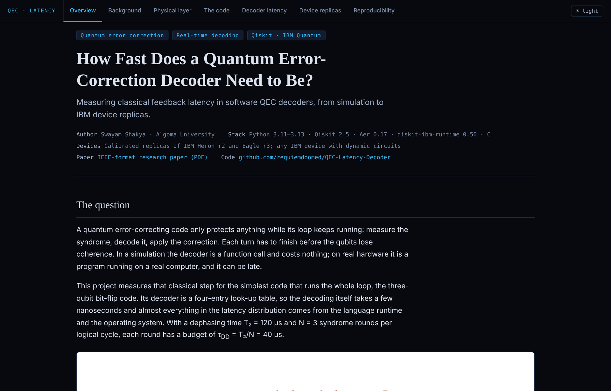
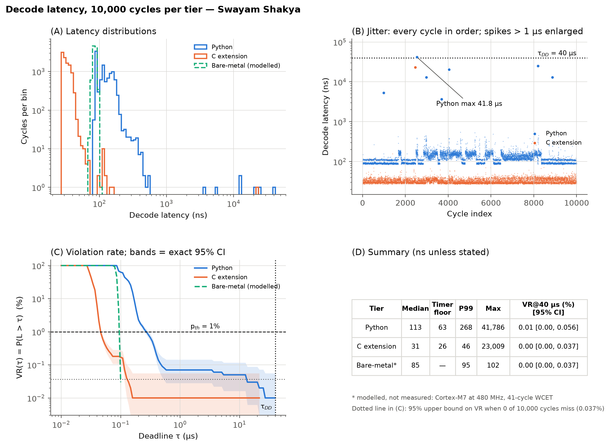
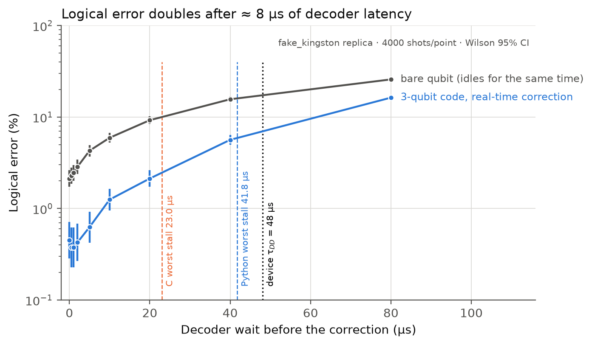

# [How Fast Does a Quantum Error-Correction Decoder Need to Be?](https://requiemdoomed.github.io/QEC-Latency-Decoder/)

**QEC Latency Decoder : Measuring Classical Feedback Latency in Software QEC Decoders, from Simulation to IBM Device Replicas**

*Swayam Shakya · 2026*



Quantum error correction only works if the loop *measure the syndrome → decode → apply the correction* finishes before the qubits lose their state. Simulations usually treat the classical part of that loop as free. This project measures it.

I used the smallest code that runs the whole loop, the three-qubit bit-flip code, whose decoder is a four-entry look-up table. Because the decoding work itself takes a few nanoseconds, almost everything in its latency distribution comes from the language runtime and the operating system. I timed the decoder in Python and in C, counted how often it misses a 40 µs coherence deadline, and then ran the code with real-time feed-forward on calibrated replicas of two IBM processors to see what each microsecond of delay costs.

---

## Headline results

| | Python decoder | C decoder |
|---|---|---|
| Typical (median) decode, reference run | 113 ns | 31 ns |
| τ\*, the deadline where 1% of cycles would miss | 268 ns | 46 ns |
| Misses at 40 µs, six full runs (660,000 cycles each) | 14 (VR ≤ 0.0036%) | 1 (VR ≤ 0.00084%) |
| Slowest single cycle, across all runs | 1.39 ms | 67.4 µs |

- **The decoder is not the bottleneck; the computer is.** A table lookup costs about 50 ns of real work in Python and 5 ns in C. Both still hit rare stalls, most likely the operating system taking the CPU away, from tens of microseconds up to 1.39 ms, and no fitted distribution predicts them.
- **C helps, but doesn't fix it.** C is 3.6× faster on a typical cycle and misses the deadline far less often (1 against 14, Fisher exact p < 0.001), but it still stalls, and one C cycle took 67 µs.
- **The code works.** At a 1% physical bit-flip rate, the logical error drops to 0.039%, 25 times fewer failures than a single qubit.
- **On calibrated IBM replicas** (Heron r2 and Eagle r3), the code with real-time feed-forward beats a bare qubit by **1.6–1.7 points of fidelity**.
- **The 40 µs deadline is a ceiling, not a target.** If the decoder waits, the logical error **doubles after only 8–13 µs**.

<p align="center">
  
</p>
<p align="center">
  
</p>

---

## The experiments

| Part | Question | Script(s) | Main result |
|---|---|---|---|
| 1. Physical layer | How fast does a qubit dephase, and which errors can a superposition feel? | `experiment_1_1_coherence.py`, `experiment_1_2_pauli_sensitivity.py` | T₂ fitted as 121.5 ± 1.3 µs (model: 120 µs); \|+⟩ is immune to X, flipped by Y and Z |
| 2. The code | Does the decoder pick the right correction, and does the code help? | `bit_flip_code.py`, `experiment_2_2_logical_error.py` | 98.61% correct decodes under noise; logical error follows 3p² − 2p³ |
| 3. Decoder latency | How long does decoding take, and how often is it late? | `fit_distribution.py`, `qec_decode.c`, `experiment_3_jitter_profiler.py`, `analysis_paper_ready.py` | Python 113 ns, C 31 ns; rare OS stalls set the deadline risk |
| 4. Device replicas | What does decoder latency cost under realistic device noise? | `experiment_4_real_hardware.py` | +1.68 / +1.62 points over a bare qubit; error doubles after 7.6 / 12.8 µs of waiting |

The full write-up is the paper in [`paper/`](paper), with an editable Word version next to the PDF. `python paper/make_paper_figures.py` regenerates all of its figures and pooled numbers from the committed data.

## The notebook

[`QEC_Latency_Decoder.ipynb`](QEC_Latency_Decoder.ipynb) is the whole project in one file. It walks through the theory, runs every experiment through the same `src/` modules that the walkthrough page shows, and draws every figure. Along the way it:

- re-checks each result with independent code (a fresh curve fit, Clopper–Pearson from beta quantiles, Mann–Whitney from ranks, the Hill estimator from its formula, the logical error rate by enumerating every error pattern);
- compares each result with theory, for example the logical error against 3p² − 2p³ at all eleven error rates;
- demonstrates each of the mistakes listed below, live;
- runs the full test suite;
- confirms that the seeded results reproduce `reference_results/`, that every code listing on the page matches the source file, and that the README, the page and the paper quote the same numbers as the data.

Every check goes into an audit log, and the last cell stops with an error if any check failed, so a clean run is itself evidence that everything agrees. The stored copy is fully executed, so you can read it on GitHub without running anything. Set `RERUN = False` in the first cell to audit the committed results in under a minute instead of rerunning the simulations.

---

## What I learned along the way

- **Wrong starting state.** The Ramsey experiment first started from |0⟩, which thermal relaxation never changes, so the fit reported T₂ = 44,142 µs. Starting from |+⟩ fixed it.
- **Overlapping random seeds.** When Aer simulates shot by shot, it seeds shot *k* with `seed + k`, so seeds 7, 8, 9 … replayed the same random stream one shot apart and gave correlated "independent" results. Seeds are now spread with `numpy.random.SeedSequence`.
- **Bootstrap intervals for rare events.** With zero misses, a bootstrap interval collapses to [0, 0], claiming a certainty the data doesn't have. Exact Clopper–Pearson intervals give an honest upper bound.
- **Unpinned qubit layouts.** Letting the transpiler place each circuit separately created a fake 0.42-point difference between offline and real-time correction. Pinning one layout made it disappear.
- **Padding with `id` gates.** The transpiler deletes `id` gates, so the "time-matched" bare qubit wasn't time-matched at all. A `delay` instruction stays.
- **The clock is part of the measurement.** Two back-to-back clock reads already cost 63 ns in Python and 26 ns in C, so most of what I first measured was the timer itself.

---

## Limitations

- No physical quantum processor was used. The device results come from snapshots, which don't drift the way real devices do.
- Aer only adds noise to instructions, so the replicas can't see the controller's own feed-forward delay. The latency sweep inserts an explicit wait as a stand-in.
- Only the decode step is timed, not readout, data transfer or dispatch of the correction.
- All timing comes from 2-vCPU cloud VMs on two CPU models. Stalls depend heavily on the host, and they are attributed to the operating system by elimination, not by tracing.
- The bit-flip code is the smallest possible code. Surface-code decoders cost far more per round, so these margins don't carry over to them.

---

## Tech stack

Python 3.11–3.13 · Qiskit 2.5.2 · Qiskit Aer 0.17.2 · qiskit-ibm-runtime 0.50.0 (client-side `Sampler`) · SciPy 1.17.1 · NumPy 2.4.6 · statsmodels 0.15.0 · Matplotlib 3.11.2 · C (GCC, ctypes) · pytest · JupyterLab

## How to cite

GitHub's **"Cite this repository"** button reads [`CITATION.cff`](CITATION.cff).

```bibtex
@software{shakya_qec_latency_decoder_2026,
  author  = {Shakya, Swayam},
  title   = {QEC Latency Decoder : Measuring Classical Feedback Latency in Software {QEC} Decoders, from Simulation to {IBM} Device Replicas},
  year    = {2026},
  version = {2.1.0},
  url     = {https://github.com/requiemdoomed/QEC-Latency-Decoder}
}
```

## Author

**Swayam Shakya (2026)**, Questions and suggestions are welcome through GitHub issues.

## License

No open-source license has been granted for this research release yet; all rights are reserved by the author. See [`LICENSE`](LICENSE) for the full notice. Third-party packages used by the project keep their own licenses.
