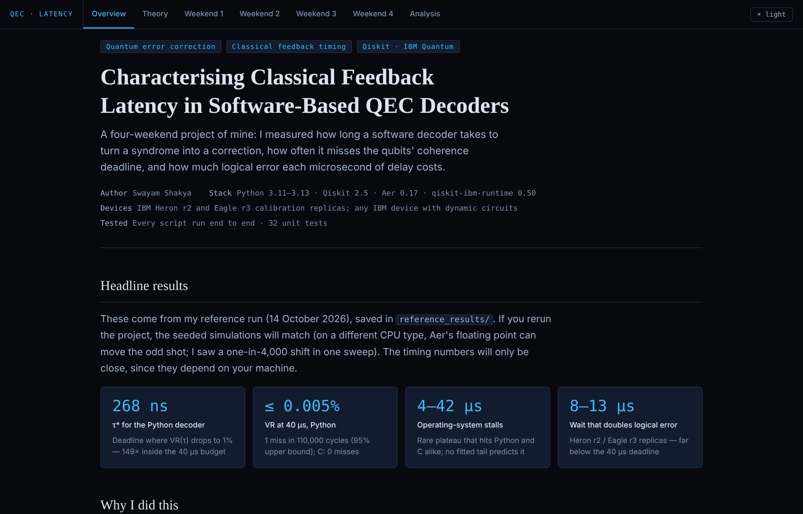
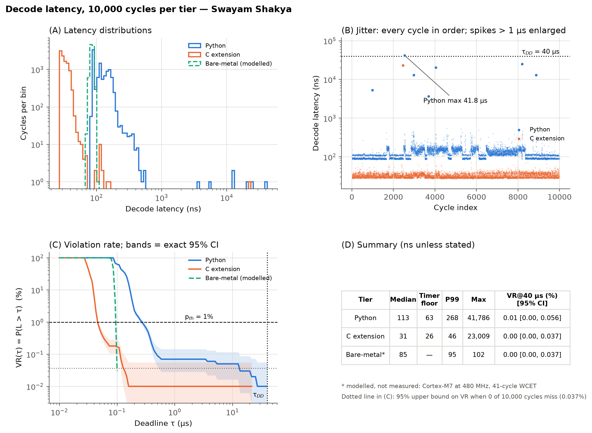
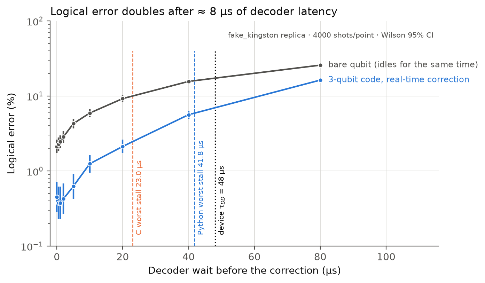

# How fast does a quantum error-correction decoder need to be?

**Measuring classical feedback latency in software QEC decoders, from simulation to IBM device replicas**

*Swayam Shakya · four-weekend research project · 2026*



Quantum error correction only works if the loop *measure the syndrome → decode → apply the correction* finishes before the qubits lose their state. Most QEC simulations treat the classical part of that loop as instant. I wanted to measure it instead.

Over four weekends I built the 3-qubit bit-flip code in Qiskit and timed its decoder in Python and in C, 10,000 cycles at a time. I counted how often a decode misses a 40 µs coherence deadline. Then I ran the code with real-time feed-forward on calibrated replicas of two IBM processors, to see what each microsecond of decoder delay costs in logical error.

**Open [`index.html`](index.html) for the full walkthrough.** To get a live link, turn on GitHub Pages (Settings → Pages → deploy from the `main` branch, root folder) and the page will be served at `https://<your-username>.github.io/<repo-name>/`. It is one self-contained page with the theory, every script (with copy buttons), all the figures and the results, organised weekend by weekend.

---

## Headline results

| | Python decoder | C decoder |
|---|---|---|
| Typical (median) decode | 113 ns | 31 ns |
| τ\*, the deadline where 1% of cycles would miss | 268 ns | 46 ns |
| Misses at the 40 µs deadline, 110,000 cycles | 1 (VR ≤ 0.0051%, 95% bound) | 0 (VR ≤ 0.0034%) |
| Slowest single cycle in the main run | 41.8 µs | 23.0 µs |

- **The decoder is not the bottleneck; the computer is.** A table lookup costs about 50 ns of real work in Python and 5 ns in C. Both tiers still hit rare **4–42 µs stalls** from the operating system, and no fitted distribution predicts them.
- **C is 3.6× faster on a typical cycle but barely changes the deadline risk**, because the stalls hit both languages.
- **The code works:** at a 1% physical bit-flip rate, the logical error drops to 0.039%, 25 times fewer failures than a single qubit.
- **On calibrated IBM replicas** (Heron r2 and Eagle r3), the code with real-time feed-forward beats a bare qubit by **1.6–1.7 points of fidelity**.
- **The 40 µs deadline is a ceiling, not a safe target.** If the decoder waits, the logical error **doubles after only 8–13 µs**.

<p align="center">
  
</p>
<p align="center">
  
</p>

---

## What's in the four weekends

| Weekend | Question | Script(s) | Main result |
|---|---|---|---|
| 1 | How fast does a qubit dephase, and which errors can a superposition feel? | `experiment_1_1_coherence.py`, `experiment_1_2_pauli_sensitivity.py` | T₂ fitted as 121.5 ± 1.3 µs (model: 120 µs); \|+⟩ is immune to X, flipped by Y and Z |
| 2 | Does the 3-qubit code pick the right correction, and does it help? | `bit_flip_code.py`, `experiment_2_2_logical_error.py` | 98.61% correct decodes under noise; logical error follows 3p² − 2p³ |
| 3 | How long does decoding take, and how often is it late? | `fit_distribution.py`, `qec_decode.c`, `experiment_3_jitter_profiler.py`, `analysis_paper_ready.py` | Python 113 ns, C 31 ns; rare OS stalls set the deadline risk |
| 4 | What does decoder latency cost on realistic device noise? | `experiment_4_real_hardware.py` | +1.68 / +1.62 points over a bare qubit; error doubles after 7.6 / 12.8 µs of waiting |

The full write-up is in [`docs/QEC_Decoder_Latency_Study_Final_Report.pdf`](docs/QEC_Decoder_Latency_Study_Final_Report.pdf). An editable Word version sits next to it.

---

## Run it yourself

You need Linux, macOS or WSL on Windows, Python 3.11–3.13 and `gcc`.

```bash
git clone <this repository> qec-decoder-latency
cd qec-decoder-latency
bash setup.sh       # makes qec-env/ and installs the pinned versions (+ pytest)
bash run_all.sh     # reruns every experiment into outputs/ (about 6 minutes on 2 cores)
source qec-env/bin/activate
pytest              # 32 unit tests
```

The seeded simulations (Weekends 1, 2 and 4) reproduce exactly on the same kind of machine. On a different CPU, Aer's floating point can shift the odd shot. When I reran everything on a newer Xeon, six of the seven seeded result files matched `reference_results/` digit for digit, and the Eagle sweep moved by one shot in 4,000 per point. The original code gives the same shift on that machine, so it comes from the hardware, not the code. The timing results (Weekend 3) depend on your machine and its load, so medians and especially the worst stalls will differ from mine. That variation is part of what the project is about.

No IBM account is needed for anything above. The Weekend 4 runs use `FakeKingston` and `FakeSherbrooke`, the calibration snapshots of real devices that ship with `qiskit-ibm-runtime`.

### Running on a real IBM quantum computer

```bash
python src/save_ibm_account.py                          # asks for your API key once
python src/experiment_4_real_hardware.py submit         # least-busy device with dynamic circuits
python src/experiment_4_real_hardware.py retrieve <job_id>
```

The job is 3 circuits × 4,000 shots, which fits easily in the free Open Plan's 10 minutes per 28 days. I haven't run this step yet. It's the main next step for the project.

---

## Repository layout

```
├── index.html              ← demo page: the whole project in one file
├── README.md
├── requirements.txt        pinned stack (qiskit 2.5.2, aer 0.17.2, runtime 0.50.0, scipy, numpy…)
├── requirements-dev.txt    + pytest
├── setup.sh                one-time environment setup
├── run_all.sh              reruns everything into outputs/
├── src/                    all experiment code (Python + the C decoder)
├── tests/                  pytest unit tests
├── reference_results/      my reference run: JSON data, figures (PNG + PDF), LaTeX table
├── docs/                   final report (PDF and Word) and screenshots
├── site/                   builds index.html from the code in src/
└── .github/workflows/      runs the tests on every push (Python 3.11–3.13)
```

More screenshots: [code view in light mode](docs/screenshots/weekend3.png) · [phone layout](docs/screenshots/mobile.png).

The code blocks in `index.html` are generated from the files in `src/`, so the page always shows exactly the code that ran. After changing code, rebuild the page with `pip install pygments pillow && python site/build_html.py`.

---

## Things that went wrong (and what I learned)

My first version ran without errors but gave several quietly wrong answers. These were the most instructive:

- **Wrong starting state.** The Ramsey experiment first started from |0⟩, which thermal relaxation never changes, so the fit reported T₂ = 44,142 µs. Starting from |+⟩ fixed it.
- **Overlapping random seeds.** Aer seeds shot *k* with `seed + k`, so neighbouring seeds (7, 8, 9…) share almost the same random stream and gave correlated "independent" results. I now spread seeds with `numpy.random.SeedSequence`.
- **Bootstrap intervals for rare events.** With zero misses, a bootstrap interval collapses to [0, 0], which claims a certainty the data doesn't have. Exact Clopper–Pearson intervals give an honest upper bound.
- **Unpinned qubit layouts.** Letting the transpiler place each circuit separately created a fake 0.42-point difference between offline and real-time correction. Pinning one layout made it disappear.
- **Padding with `id` gates.** The transpiler deletes `id` gates, so the "time-matched" bare qubit wasn't time-matched at all. A `delay` instruction stays.
- **The clock is part of the measurement.** Two back-to-back clock reads already cost 63 ns in Python and 26 ns in C, so most of what I first measured was the timer itself.

The full list (14 items) is on the Overview tab of `index.html` and in Appendix B of the report.

---

## Limitations

- No physical QPU run yet. The device results come from calibration snapshots, which don't drift the way real devices do.
- Aer only adds noise to instructions, so the replicas can't see the controller's own feed-forward delay. The latency sweep inserts an explicit wait as a stand-in.
- I timed the decode step only, not readout, data transfer or dispatch of the correction.
- All timing comes from one 2-vCPU cloud VM. Stalls depend heavily on the host.
- The bit-flip code is the smallest possible code. Surface-code decoders are much slower per round, so these margins don't carry over to them.

---

## Tech stack

Python 3.11–3.13 · Qiskit 2.5.2 · Qiskit Aer 0.17.2 · qiskit-ibm-runtime 0.50.0 (client-side `Sampler`) · SciPy 1.17.1 · NumPy 2.4.6 · statsmodels 0.15.0 · Matplotlib 3.11.2 · C (GCC, ctypes) · pytest

## References

1. A. G. Fowler, M. Mariantoni, J. M. Martinis, A. N. Cleland, *Surface codes: Towards practical large-scale quantum computation*, Phys. Rev. A 86, 032324 (2012).
2. B. M. Terhal, *Quantum error correction for quantum memories*, Rev. Mod. Phys. 87, 307 (2015).
3. B. M. Hill, *A simple general approach to inference about the tail of a distribution*, Ann. Statist. 3, 1163 (1975).
4. C. J. Clopper, E. S. Pearson, *The use of confidence or fiducial limits illustrated in the case of the binomial*, Biometrika 26, 404 (1934).
5. A. Javadi-Abhari et al., *Quantum computing with Qiskit*, arXiv:2405.08810 (2024).

## Author

**Swayam Shakya**. Questions and suggestions are welcome through GitHub issues.

Released under the [MIT License](LICENSE).
